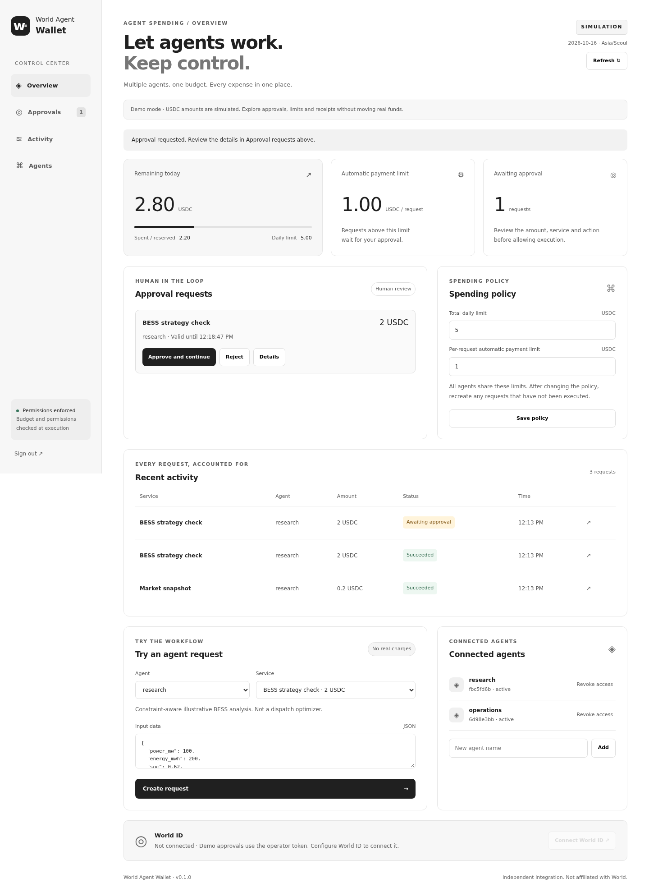

# World Agent Wallet

**An MCP payment plugin for agents. Manage shared budgets, human approvals and payment records in one place.**

World ID · AgentBook · World Chain USDC · x402 · MCP

An independent project, not an official World product.



## v0.1.0 scope

The project includes a **local MVP that runs without API keys** and **adapters for World and x402 integration**. The server enforces operator-defined limits; agents cannot approve requests or change those limits.

| Feature            | Implementation and validation                                                                                              |
| ------------------ | -------------------------------------------------------------------------------------------------------------------------- |
| MCP stdio plugin   | Integration tests with the official MCP SDK client cover discovery, payment, resuming after approval and receipt retrieval |
| Shared budget      | Integer USDC units, SQLite transactions and concurrent-request limit checks                                                |
| Human approval     | Bound to the amount, service, input, expiry and policy version                                                             |
| World ID           | IDKit 4.4.0, server-side RP signatures, Proof of Human verification and matching the enrolled approver                     |
| AgentBook          | Looks up the signing wallet's World Chain registration and attempts AgentKit free access                                   |
| x402               | v2 exact / World Chain / USDC / EIP-3009; real SDK signing and settlement verification against RPC response fixtures       |
| Operator dashboard | Approval and rejection, shared limits, agent issuance and revocation, history and mobile layout                            |
| Failure handling   | Duplicate-execution suppression, preservation of uncertain outcomes across restarts and no automatic repeat payments       |

**Actual World ID app verification and mainnet transfers have not been performed.** These require an app configuration, a registered wallet, funds and a compatible API. The integration code passes tests with simulated identity/chain responses and real signing SDKs; live integration validation is still required before handling real funds.

## Quick start

Requires **Node.js 24 or newer**. The database uses Node's built-in SQLite.

```bash
npm ci
npm run build
npm start
```

1. Open `http://127.0.0.1:8787`.
2. Paste the value from `.local/admin-token`, created on first startup, into the operator sign-in form.
3. Under **Try an agent request**, run `Market snapshot` to simulate a 0.2 USDC payment.
4. Run `BESS strategy check` to create a 2 USDC approval request.
5. Approve the request to execute it and update the receipt and remaining budget.

Defaults are **5 USDC per day**, automatic payments up to **1 USDC per request**, and an **Asia/Seoul** day boundary. These amounts are numbers in a demo ledger; no funds move. Without an enrolled World ID, demo approvals use a separate operator token.

The interface, messages, documentation and examples default to English. Display times use an English locale without changing the configured budget day boundary. User-provided agent names and request data are preserved as entered.

You can also exercise the complete flow without the UI:

```bash
npm run demo
```

Credential files and the database are stored in `.local/` and excluded from Git. Operator and agent tokens are separate. Give agents only `agent-research.json` or `agent-operations.json`.

## Connect an agent

Start the gateway with `npm start`. Add the following to an MCP stdio host's configuration, replacing the paths with actual absolute paths:

```json
{
  "mcpServers": {
    "world-agent-wallet": {
      "command": "node",
      "args": ["/absolute/path/world-agent-wallet/src/mcp.mjs"],
      "env": {
        "WALLET_GATEWAY_URL": "http://127.0.0.1:8787",
        "WALLET_AGENT_FILE": "/absolute/path/world-agent-wallet/.local/agent-research.json"
      }
    }
  }
}
```

On Windows, use absolute paths such as `C:/projects/world-agent-wallet/...`. Do not give the MCP process the operator token or wallet private key. This release provides **stdio MCP**; it does not include a Streamable HTTP/OAuth deployment for cloud hosts.

Example agent request:

> Check the budget with wallet_status and purchase market-snapshot once. Give prepare_payment a unique idempotency_key. If the operation is ready, call execute_payment. If it is awaiting approval, tell me and resume with the same operation_id after approval.

| Tool              | Purpose                                                                  |
| ----------------- | ------------------------------------------------------------------------ |
| `wallet_status`   | Agent status and shared budget                                           |
| `list_services`   | Operator-allowed services and price ceilings                             |
| `prepare_payment` | Validate input, obtain a quote and prepare execution or request approval |
| `execute_payment` | Execute an existing operation after budget and approval checks           |
| `get_receipt`     | Status and result of a specific operation                                |
| `list_receipts`   | Recent operations for the requesting agent                               |

`prepare_payment` does not pay, but it may consume a provider's free-trial API call. Use the **same idempotency_key** when retrying a request. If you miss a successful `execute_payment` response, retrieve the receipt using the same operation_id.

## Connect World and live payments

See [docs/world-integration.md](docs/world-integration.md) for the integration procedure.

1. Register an app/RP in the World Developer Portal and enter the World settings in `.env`.
2. Enroll the owner's World ID in the dashboard. Subsequent approvals must come from the same person.
3. Register a dedicated payment wallet in AgentBook.
4. Copy `examples/services.live.json` and configure the **exact URL, recipient and price ceiling of APIs you trust**.
5. Use a separate data directory, `WALLET_MODE=x402` and the production World environment.

`.env.example` contains empty configuration placeholders only. A demo data directory cannot be reused for live payments. The project does not call model APIs, so no LLM provider API key is required.

## Validation

```bash
npm run check
npm test
npm run build
npm run demo
```

Tests do not use real funds. They cover concurrent spending, approval tampering, wrong-person approvals, duplicate payments, agent-scoped access, policy changes, expiry, restarts, World ID response validation, x402 SDK signing and the complete MCP workflow. See [testing and integration limits](docs/validation.md) for the test contracts and remaining checks.

For the local dashboard browser checks, install Chromium with `npx playwright install chromium`, then run `npm run test:e2e`. These checks use an in-memory demo ledger and block non-loopback browser requests.

## Operating model and boundaries

- One operator, multiple agents and one wallet with a shared budget. AgentBook registration applies to the **shared signing wallet**, not to individual plugin agents.
- Costs are reserved on the **date payment authorization is issued**, which may differ from the chain settlement date. Fees and spending outside the gateway are not included in this budget.
- Only requests through the gateway are controlled. The gateway cannot prevent direct use of external payment tools or wallets.
- The server binds to loopback by default. Remote deployment needs a separate TLS, authentication, key-management and routing review.
- Processes that can access the server's private key or operator token are inside the trust boundary. Use separate accounts or hosts for agents and the gateway if stronger isolation is required.
- Live payments support only operator-registered **read-only GET APIs**. Arbitrary URLs, token transfers, swaps and smart-contract calls are not exposed.
- Public-chain records and AgentBook's human linkage have distinct privacy implications. They do not automatically make the whole application anonymous.

See [architecture.md](docs/architecture.md) for design, [SECURITY.md](SECURITY.md) for security boundaries and [ROADMAP.md](ROADMAP.md) for future scope.

## Official references

- [World AgentKit](https://docs.world.org/agents/agent-kit/integrate)
- [World ID / IDKit](https://docs.world.org/world-id/idkit/integrate)
- [World approval integration](https://docs.world.org/agents/human-in-the-loop/integrate)
- [x402 buyer integration](https://docs.x402.org/getting-started/quickstart-for-buyers)
- [MCP server development](https://modelcontextprotocol.io/docs/develop/build-server)

Design baseline: official documentation checked on 2026-10-10 and packages pinned in `package-lock.json`.
