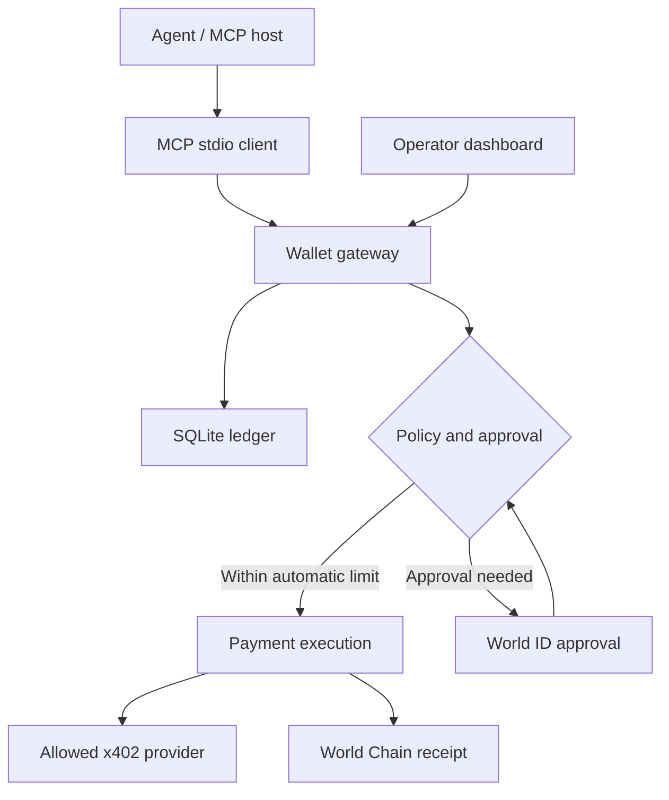
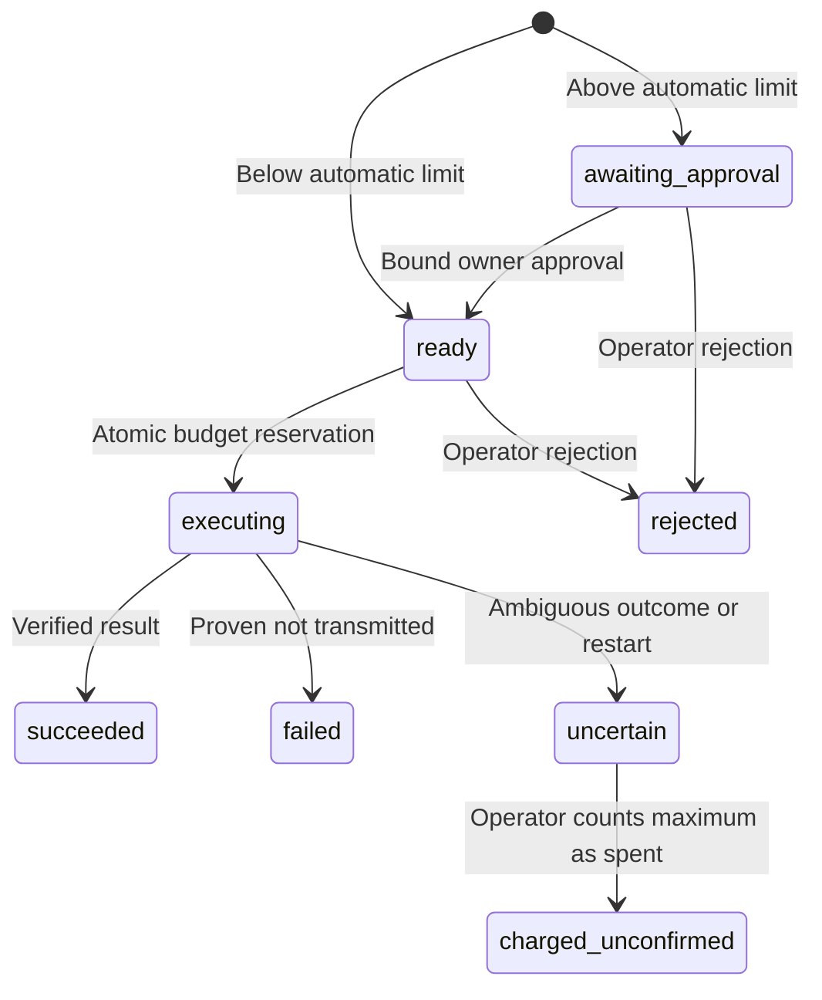

# Architecture

The local gateway is the authority. The MCP server is an authenticated client, and cannot approve its own operations or change spending policy.

## Durable state

An operation includes normalized input, a catalog digest, a payment quote, an expiry, and a policy revision. A SHA-256 digest binds all of these plus the operation and agent IDs. The stored quote is never exposed as an editable execution argument.

SQLite `BEGIN IMMEDIATE` reserves the amount before network I/O. Reservation statuses are included in the shared budget. A successful lower actual charge may reduce the reservation; unconfirmed outcomes retain its full amount. All token amounts are integer millionths of USDC.

Expired quotes remain visible with their original status for history, but cannot be approved or executed. Policy or catalog changes invalidate all unexecuted old quotes. Completed operations return the original receipt even after policy changes. No state transition retries an uncertain payment.

## World identity and authorization

The server generates an RP-signed World ID request. Every challenge has a unique nonce and signal tied to either enrollment or the exact operation digest. The UI uses IDKit `proofOfHuman` with v4 proofs only. The backend verifies the environment, nonce, action, schema, signal hash and successful matching credential returned by the Developer Portal. Nullifiers are normalized as field elements.

Enrollment records the owner's nullifier within the configured RP/action/environment. Subsequent approval must match this owner. Challenges are consumed atomically with approval. A token is still required for operator endpoints: human uniqueness alone does not grant authority over the wallet.

AgentBook independently proves that the **shared signing wallet** was registered with a World ID. Its identifier is not compared with the app-scoped owner nullifier; these have different scopes. Possession of the dedicated wallet key and the operator credential is part of this single-owner deployment's trust model. This MVP does not prove that independently scoped World identities belong to the same individual.

## Network and payment scope

Only catalog-defined HTTPS GET resources are available in live mode. DNS resolution at connection time rejects private/reserved IPs. Redirects are disabled. Body sizes, network timeouts and request body sizes are bounded.

The x402 quote is pinned to network `eip155:480`, the documented World Chain USDC contract, the configured recipient and price ceiling, the exact scheme and EIP-3009 signing domain. Permit2 and arbitrary extensions are not forwarded to the signer. Payment authorizations have at most a 300-second lifetime.

After transmitting one authorization, the adapter requires a matching World Chain transfer **and AuthorizationUsed nonce** in a successful transaction receipt. A provider-supplied receipt alone is insufficient. The MVP waits for one L2 confirmation, not Ethereum finality. Reorg/finality handling beyond this remains future work.

## Deployment assumptions

Run one gateway process per data directory. A lock prevents a second gateway from falsely treating a running payment as a crashed one. Several stdio MCP clients may connect to that gateway. Each has a distinct bearer token, stored only as a hash in the database.

The operator UI uses sessionStorage, same-origin requests and a restrictive CSP. Tokens and private keys belong to the trusted server/operator environment. This is not a defense against malicious code that already has filesystem access to the same account.

No automatic retry is performed after an ambiguous settlement. The operator may acknowledge the maximum amount as spent to resume live requests; this does not assert successful on-chain settlement or release the reserved funds.
